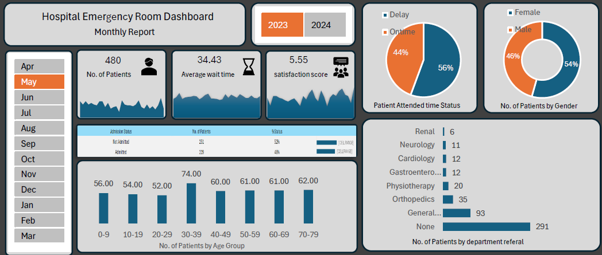

# 🏥 Hospital Emergency Room Service Analysis

An end-to-end data analytics project in **Excel** that analyzes **9,216 emergency room visits (April 2023 – October 2024)** to understand patient volume, waiting times, attendance delays, patient satisfaction, admissions and referrals, and to turn those findings into practical recommendations for the hospital.

---

## 📊 Dashboard Preview



> The preview shows the **April 2024** view. The dashboard has **year (2023 / 2024)** and **month** slicers, so any month in the dataset can be selected.

---

## 📌 Table of Contents
1. [Project Overview](#-project-overview)
2. [Business Problem and Objectives](#-business-problem-and-objectives)
3. [Dataset](#-dataset)
4. [Data Cleaning and Preparation](#-data-cleaning-and-preparation)
5. [Methodology](#-methodology)
6. [Dashboard Features](#-dashboard-features)
7. [Key Findings](#-key-findings)
8. [Recommendations](#-recommendations)
9. [Limitations](#-limitations)
10. [Repository Structure](#-repository-structure)
11. [Tools and Skills](#-tools-and-skills)
12. [How to Use](#-how-to-use)
13. [Author](#-author)

---

## 🔎 Project Overview

Emergency rooms run under constant pressure: demand is unpredictable, and delays directly affect patient experience. This project analyzes ER data to find **where delays occur, who is affected, and what the hospital can do about it**.

The work covers the full analytics workflow: data cleaning, pivot-table analysis, an interactive dashboard, and a written business report with recommendations.

---

## 🎯 Business Problem and Objectives

**Problem:** The hospital needs to understand ER performance, especially waiting times and delays, so it can plan staffing, set realistic targets and improve patient experience.

**Objectives**
- Measure patient volume and identify peak and low-demand periods
- Evaluate waiting time and attendance timeliness
- Assess patient satisfaction and the reliability of that data
- Understand patient demographics, admissions and referral patterns
- Recommend actions backed by the data

---

## 🗂️ Dataset

| Item | Detail |
|---|---|
| Source | Synthetic hospital Emergency Room dataset |
| Records | 9,216 patient visits |
| Period | 1 April 2023 – 30 October 2024 |
| Fields (after cleaning) | Patient Id, Admission Date, Admission Time, Full Name, Gender, Age, Race, Department Referral, Admission Flag, Satisfaction Score, Waittime |

📁 Raw data: [`dataset/Hospital Emergency Room Data.csv`](dataset/Hospital%20Emergency%20Room%20Data.csv)

---

## 🧹 Data Cleaning and Preparation

| # | Step | Column | Purpose |
|---|---|---|---|
| 1 | Removed `-` from ID values | Patient Id | Clean IDs for distinct patient counts |
| 2 | Split into Admission Date and Admission Time | Patient Admission Date | Enables daily/monthly and time-of-day analysis |
| 3 | Merged name initial and surname | Patient Full Name | Single readable name field |
| 4 | Replaced `M` → Male and `F` → Female | Patient Gender | Consistent gender categories |
| 5 | Changed data type from Boolean to Text | Patient Admission Flag | Readable "Admitted / Not Admitted" labels |
| 6 | Deleted duplicate column | Patient Admission Flag.1 | Identical to the main flag in every row |

**Quality checks:** no duplicate patient IDs or rows, no invalid dates, age within 1–79, wait time within 10–60 minutes, and continuous daily records across the period.

**Derived fields and rules**
- **Age group:** 10-year bands (0–9 to 70–79)
- **Attendance status:** *Delayed* if wait time is **over 30 minutes**, otherwise *On time*
- **Department Referral:** blank values reported as "None" (5,400 records)
- **Satisfaction score:** average of recorded scores, **excluding zeros**; only 27.3% of patients have a score

---

## ⚙️ Methodology

1. Cleaned and transformed the raw CSV
2. Built **pivot tables** for volume, wait time, satisfaction, age, gender, admission, referral and attendance status
3. Added **slicers** (year and month) to filter every view
4. Designed an interactive **KPI dashboard**
5. Recalculated all figures from the raw data to cross-check the dashboard
6. Wrote a business report with findings, recommendations and limitations

---

## 📈 Dashboard Features

- **KPI cards:** number of patients, average wait time, satisfaction score
- **Trend charts** for daily patient count, wait time and satisfaction
- **Attendance status** (Delayed vs On time) pie chart
- **Gender split** donut chart
- **Admission status** table (Admitted vs Not Admitted)
- **Patients by age group** column chart
- **Patients by department referral** bar chart
- **Year and month slicers** for interactive filtering

---

## 💡 Key Findings

Figures below cover the **full dataset** (April 2023 – October 2024).

| Metric | Result |
|---|---|
| Total patients | **9,216** |
| Average patients per day | **~16** (range 7 to 30) |
| Average wait time | **35.3 minutes** |
| Patients delayed (wait > 30 min) | **59.3%** (58.0% in 2023 → 60.5% in 2024) |
| Patients waiting over 45 minutes | **~30%** |
| Average satisfaction (excluding zeros) | **5.47 / 10** (only 27.3% of patients scored) |
| Admission rate | **50.0%** |
| Patients with no referral recorded | **58.6%** |

**Highlights**
- **Wait time is not driven by volume.** The correlation between daily patient count and daily wait time is just **0.04**. Delays look like a process or staffing issue, not overcrowding.
- **Delays affect everyone.** The delay rate is roughly the same across age groups, genders and admission status.
- **Demand is stable but spiky.** Daily volume swings from 7 to 30 patients, with no strong weekday pattern.
- **Demographics are balanced.** Every age group makes up 11.5%–13.0% of visits, and the gender split is about 51% male / 49% female.
- **Referrals are concentrated.** General Practice and Orthopedics account for about 75% of referred patients.
- **Satisfaction cannot be measured reliably yet.** About 73% of patients have no score, and the score shows no link to waiting time in this data.

> **Dashboard vs report:** the dashboard shows one month and year at a time (the preview above is April 2024: 469 patients, 35.04 min average wait, 5.16 satisfaction). Full-period figures in the report were calculated from the raw data.

---

## ✅ Recommendations

| # | Recommendation | Priority |
|---|---|---|
| 1 | Introduce flexible surge staffing for peak-volume days | High |
| 2 | Review the 30-minute attendance target and set a stepped goal (delayed rate below 50% in 12 months) | High |
| 3 | Investigate the causes of long waits (triage, handovers, arrival time) rather than adding capacity based on volume | High |
| 4 | Raise satisfaction survey coverage and fix one rule for zero scores | High |
| 5 | Size the inpatient bed buffer for peak-day admissions (16–17), not the daily average (~8) | Medium |
| 6 | Strengthen General Practice and Orthopedics follow-up capacity and make the referral field mandatory | Medium |
| 7 | Fix data quality at source (consistent coding, no duplicate columns, recorded delay rule) | Medium |

The full business report, including business questions, drill-downs and an action plan, is in the `Report` folder.

---

## ⚠️ Limitations

- The dataset is **synthetic** and may not reflect real hospital operations
- Covers 19 months only, which is too short to establish long-term trends
- No cost, diagnosis, triage acuity, staffing, bed occupancy or length-of-stay data
- The data shows **associations, not causes**
- The **30-minute delay rule** was inferred from the dashboard figures, as the raw data has no delay field
- Zero satisfaction scores were treated as "not answered", which is an assumption
- A blank referral could mean "not needed" or "not recorded"

---

## 📁 Repository Structure

```
Hospital-Emergency-Service-Analysis/
│
├── DASHBOARD/
│   ├── hospital emergncy analysis_cleaned.xlsx          # Cleaned data, pivot tables, interactive dashboard
│   └── hospital_emergency_dataAnalytics_Dashboard.pdf   # Dashboard export
│
├── dashboard_preview/
│   └── hospital_emergency_dashboard.png                 # Dashboard screenshot used in this README
│
├── dataset/
│   └── Hospital Emergency Room Data.csv                 # Raw dataset
│
├── Report/
│   └── Hospital_ER_Performance_Report.pdf               # Full business report
│
├── .gitignore
└── README.md
```

---

## 🛠️ Tools and Skills

- **Microsoft Excel:** pivot tables, slicers, calculated fields, dashboard design
- **Data cleaning and transformation**
- **KPI design and business analysis**
- **Data storytelling and report writing**

---

## ▶️ How to Use

1. Clone the repository:
   ```bash
   git clone https://github.com/SuprakashSaha/Hospital-Emergency-Service-Analysis.git
   ```
2. Open `DASHBOARD/hospital emergncy analysis_cleaned.xlsx` in Microsoft Excel and use the **year** and **month** slicers to explore the dashboard.
3. Read the full analysis in `Report/Hospital_ER_Performance_Report.pdf`.
4. The raw data is in `dataset/` if you want to repeat the analysis.

---

## 👤 Author

**Suprakash**
Aspiring Data Analyst | Kolkata, India


⭐ If you found this project useful, consider giving the repo a star.
